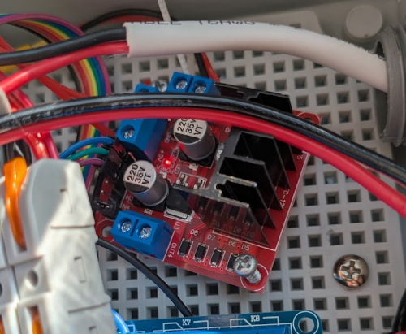
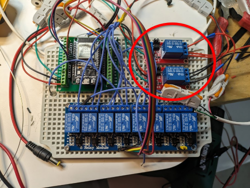
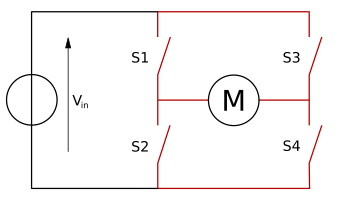

### The next iteration in motor control
It's always interesting to watch the evolution of projects like these from initial development to something a bit more polished, maybe a bit more stable as well. Initial development is often a rough working concept. Depending on the situation and time investment, maybe that rough working concept is good enough to live with. Other times, maybe something more elegant is desired.

In the case of this project, I knew the initial rough design was temporary, but I wasn't yet aware of possible solutions outside of just creating a customized circuit to handle my needs. Luckily I have a friend who was immediately more aware of the electronic components out there. I mentioned to him my current configuration and he almost immediately suggested using this marvelous device. Anyway, I'm getting ahead of myself. Let's take a look at what I had initially.


### The initial system
The motors used to control the sprinkler valves reverse their polarity in order for them to open or close. So, the positive lead for opening the valve becomes the negative lead when closing, and _vice versa_. The two relays circled above were what I had initially used to control switching the polarity of the motors. The way that this worked is that the common pin on either relay was what took in power from the power source and the NO/NC (normally open/normally closed) pins were each paired in a way that they would allow them to switch polarity when the relay switch was activated. The other end of the leads connected to a bus that distributed power to all the individual relays controlling the valves.

While this system mostly worked, it had some big drawbacks. Namely, there could be issues with the relays not switching at exactly the same moment. When a positive and negative lead combine without a 'load' or resistance, that's a short circuit! (2025 note from editor me - I still kinda cringe that I didn't immediately catch this :) ). I did have sufficient safety measures in place to prevent a catastrophic situation, though this is still a situation one should try to avoid. 

### The new component
H-bridges are neat little devices. Let's first do a quick overview. [Wikipedia](https://en.wikipedia.org/wiki/H-bridge) says:
> An h-bridge is an electronic circuit that switches polarity of a voltage applied to a load. These circuits are often used in robotics and other applications to allow DC motors to run forwards or backwards. The name is derived from its common schematic diagram representation, with four switching elements configured as the branches of the letter "H" and the load connected as the cross-bar.

Sounds like it does right what it says on the can. Looking at a simple schematic (below), it looks like there's effectively not much difference between what my initial solution did and what the h-bridge does...



...That would be incorrect though! H-bridges are actually a much more robust system. I mean, that would make sense, right? I just threw two relays together in a pinch. I'd hope someone built a module that wasn't just two relays bound together with  tin solder, super glue and magic smoke. An H-bridge actually takes the switching action to a new level to prevent short-circuits by creating 'dead time'. It does this by using pulse-width modulation (PWM) to control when the power gets sent to the motor. More specifically, it uses what's called "Complementary PWM" to ensure that conflicting signals to the relays never happen. There's always a small buffer of time between the signal changes to avoid a condition called "shoot-through", which is the main way a short circuit can happen.

To learn more about h-bridges, note that I used [this site](https://www.allaboutcircuits.com/technical-articles/h-bridge-dc-motor-control-complementary-pulse-width-modulation-pwm-shoot-through-dead-time-pwm/) to supplement the data I collected from wikipedia for this. If you're looking for better understanding on the matter, their diagrams really helped me grasp the concepts.

### Implementing the h-bridge
Implementing this was actually way easier than implementing the two relays used before. For this project, I used the L298N model of h-bridges. It takes a 5V and "12V" lead. The 5V lead powers the supporting circuit and the "12V" (in quotes because while it's labelled that, it actually supports up to 35V) powers the motors under its control. On top of the power supply, we just need to add three connections:
  - `IN1` and `IN2` to control the polarity of our motor
  - `ENA` to control the motor speed

Interestingly, the setup of this in ESPHome has you set this component up as a fan. It makes sense, given that fans are one of the more popular applications of this, but it did initially strike me as odd. Naming things in this industry truly is the most difficult and unforgiving task! Here's what my ending config looked like in ESPHome:
```yaml
output:
  - platform: ledc
    id: motor_forward_pin
    pin: GPIO27 # Pin to IN1
  - platform: ledc
    id: motor_reverse_pin
    pin: GPIO12  # Pin to IN2
  - platform: ledc
    pin: GPIO14   # Pin to EAN
    id: motor_speed
    frequency: 1000Hz

fan:
  - platform: hbridge
    id: main_motor_control
    name: "Sprinkler Motor Control"
    pin_a: motor_forward_pin
    pin_b: motor_reverse_pin
    enable_pin: motor_speed
```

